<a name="top"></a>
<h1 align="center">k3s-wake-on-demand-homelab</h1>

<p align="center">
  <b>An energy-efficient home cluster.</b><br>
  A Raspberry Pi 5 runs Kubernetes (K3s) 24/7 and wakes the power-hungry machines<br>
  (a CPU node and a GPU node that also serves as NAS) <b>only when there is work for them</b>.
</p>

<p align="center">
  <a href="docs/guide/README.md"><b>Installation guide</b></a> &nbsp;·&nbsp;
  <a href="docs/decisions.md"><b>Design decisions</b></a> &nbsp;·&nbsp;
  <a href="docs/lessons-learned.md"><b>Lessons learned</b></a> &nbsp;·&nbsp;
  <a href="#architecture"><b>Architecture</b></a>
</p>

<div align="center">

| Layer | Stack |
|:--|:--|
| **Platform** | [](https://k3s.io) [](https://www.raspberrypi.com) [](https://ubuntu.com) [](https://podman.io) [](https://developer.nvidia.com/cuda-toolkit) |
| **Network & security** | [](https://www.wireguard.com) [](https://wiki.nftables.org) [](https://www.crowdsec.net) [](https://traefik.io/traefik/) [](https://letsencrypt.org) [](https://www.duckdns.org) [](https://www.authelia.com) |
| **Services** | [](https://fastapi.tiangolo.com) [](https://beszel.dev) [](https://restic.net) [](https://immich.app) [](https://filebrowserquantum.com) [](https://www.blender.org) |

[](LICENSE)

| **~35 s** | **1 port** | **every 3 days** | **1 push** |
|:--:|:--:|:--:|:--:|
| to wake a sleeping node | open to the internet | encrypted backups | to deploy an app |

</div>

<p align="center">
  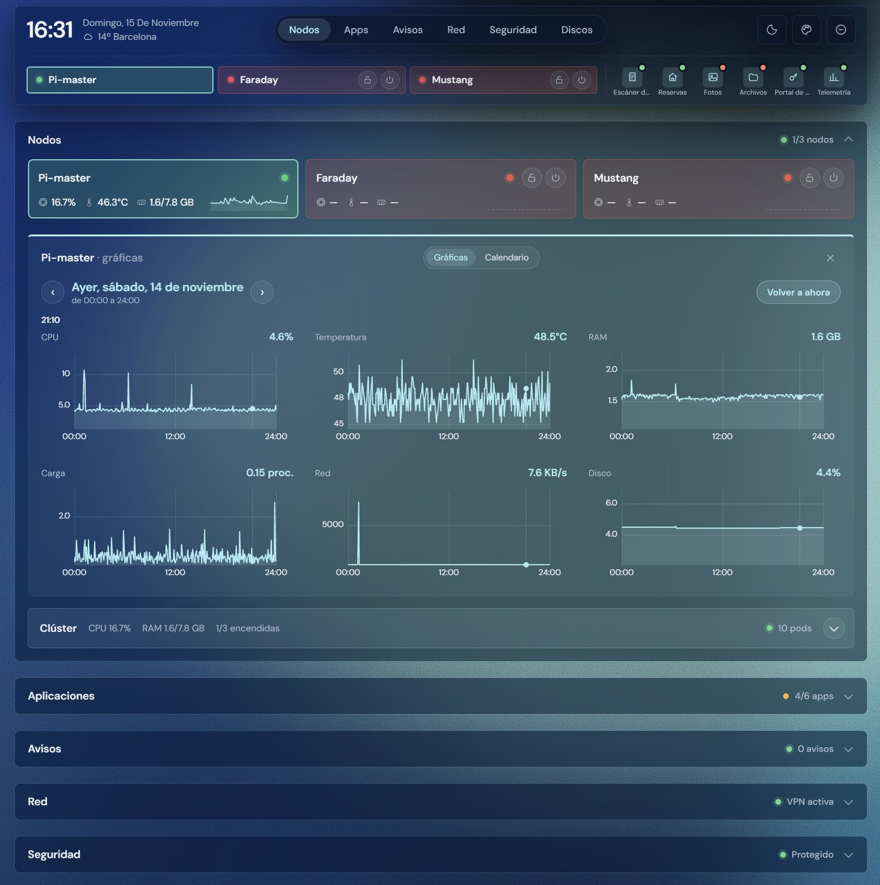
</p>

---

## Contents

<table>
<tr>
<td valign="top" width="50%">

**The project**
- [About](#about)
- [Architecture](#architecture) · [technology by layer](#technology-by-layer)
- [How wake-on-demand works](#how-wake-on-demand-works)
- [Features](#features) · [the dashboard at a glance](#the-dashboard-at-a-glance) · [themes](#themes)
- [What runs on it](#what-runs-on-it)
- [Hardware](#hardware)

</td>
<td valign="top" width="50%">

**Using it**
- [Installation guide](#installation-guide)
- [Design decisions & lessons learned](#design-decisions--lessons-learned)
- [Quick start](#quick-start)
- [Repository layout](#repository-layout)
- [Roadmap](#roadmap)
- [License](#license)

</td>
</tr>
</table>

---

## About

I had two old desktop PCs gathering dust at home and a growing list of things I wanted a server for:
a private place for my photos and files, somewhere to run my own apps, and the occasional heavy job
such as a 3D render. I also wanted a real playground to learn the things that are hard to learn from
a book: **HPC scheduling, networking, Linux administration and security**, on hardware I could break
and fix myself.

Leaving two desktops on all day was not an option: they waste energy and wear out their disks for
work that only happens now and then. So the idea became a cluster that is **asleep most of the time**:
a Raspberry Pi 5 stays on as the brain, and the PCs are switched on only when there is work for them.

- A **job** submitted to K3s that needs a node wakes it up with Wake-on-LAN, runs, and the node powers
  off again once it has been idle for a while.
- **Opening a service** that lives on a sleeping node (the photo library, the file browser) wakes it
  automatically; a "waking up…" page redirects you about 35 seconds later.
- Everything else (VPN, single sign-on, dashboard, monitoring, backups, my own apps) runs on the Pi,
  which never sleeps.

It started as a classic HPC setup with **Slurm** and evolved into **Kubernetes (K3s)** once it also had
to run long-lived services; the reasons for that and every other choice are in the
[design decisions](docs/decisions.md).

---

## Architecture

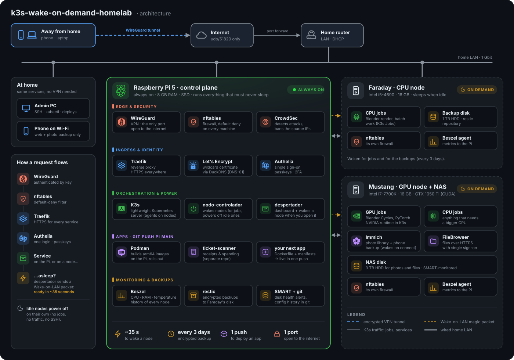

### Technology by layer

<details open>
<summary><b>What each piece does</b> (click to fold)</summary>
<br>

<table>
<thead><tr><th align="left">Layer</th><th align="left">Technology</th><th align="left">Role</th></tr></thead>
<tbody>
<tr><td rowspan="3" valign="top"><b>Network&nbsp;edge</b></td><td valign="top"><b>WireGuard</b></td><td>The only port open to the internet; everything else is reachable from the VPN or the home LAN only</td></tr>
<tr><td valign="top"><b>nftables</b></td><td>Default-deny firewall on every machine; K3s services only reachable through Traefik</td></tr>
<tr><td valign="top"><b>CrowdSec</b></td><td>Reads the SSH, Traefik and firewall logs, detects attacks and bans the source IPs</td></tr>
<tr><td rowspan="2" valign="top"><b>Ingress</b></td><td valign="top"><b>Traefik</b></td><td>Reverse proxy and HTTPS for every service (bundled with K3s)</td></tr>
<tr><td valign="top"><b>Let's&nbsp;Encrypt&nbsp;+&nbsp;DuckDNS</b></td><td>Free wildcard certificate via DNS-01: valid HTTPS without buying a domain or opening ports</td></tr>
<tr><td rowspan="1" valign="top"><b>Identity</b></td><td valign="top"><b>Authelia</b></td><td>One login for everything, with passkeys (WebAuthn) and two-factor for sensitive apps</td></tr>
<tr><td rowspan="1" valign="top"><b>Orchestration</b></td><td valign="top"><b>K3s</b></td><td>Lightweight Kubernetes: server on the Pi, agents on the nodes, tainted so only on-demand work lands there</td></tr>
<tr><td rowspan="2" valign="top"><b>Power</b></td><td valign="top"><b>nodo-controlador</b></td><td><i>Own.</i> Wakes a node when a pending job needs it, powers it off after an idle period</td></tr>
<tr><td valign="top"><b>despertador</b></td><td><i>Own.</i> The dashboard, plus a wake-on-access proxy for services on sleeping nodes</td></tr>
<tr><td rowspan="1" valign="top"><b>Apps</b></td><td valign="top"><b>Podman&nbsp;+&nbsp;git&nbsp;hook</b></td><td><i>Own.</i> <code>git push pi main</code> builds the image on the Pi and rolls it out to K3s</td></tr>
<tr><td rowspan="2" valign="top"><b>Monitoring</b></td><td valign="top"><b>Beszel</b></td><td>Metrics history of every machine</td></tr>
<tr><td valign="top"><b>smartmontools</b></td><td>Disk health checks, surfaced as alerts in the dashboard</td></tr>
<tr><td rowspan="1" valign="top"><b>Backups</b></td><td valign="top"><b>restic</b></td><td>Encrypted, deduplicated backups to a disk in the CPU node, woken for the occasion</td></tr>
</tbody>
</table>

</details>

> **Why these pieces and not others?** Every choice, and the alternatives that were rejected, is in
> [**Design decisions**](docs/decisions.md).

---

## How wake-on-demand works

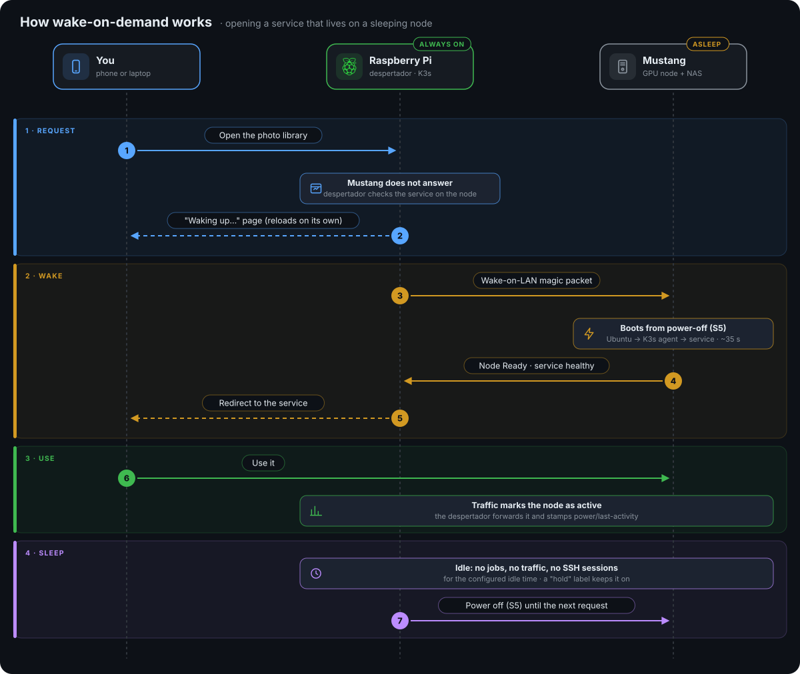

The same controller handles batch work: a K3s **Job** with the right `nodeSelector` and toleration
wakes the matching node (CPU or GPU), and the node sleeps again once the job is done.
→ Details in [guide · chapter 4](docs/guide/04-power.md) and [chapter 8](docs/guide/08-dashboard.md).

---

## Features

<table>
<tr>
<td valign="top" width="50%">

### Power management
- Nodes fully powered off (S5) and woken by Wake-on-LAN, not just suspended.
- Idle detection that is hard to fool: pending jobs, recent service traffic, open SSH sessions and a manual "hold" label all keep a node awake.
- Handles a real motherboard quirk: a node that switches itself back on after its first shutdown is watched and powered off again.

</td>
<td valign="top" width="50%">

### Security
- Nothing exposed to the internet except WireGuard; the services domain resolves to a **private** IP.
- Default-deny nftables on all machines, with separate rules for the K3s forward path.
- Single sign-on with passkeys; two-factor for apps with financial data.
- CrowdSec in protecting mode; your own devices and the VPN can never be banned.

</td>
</tr>
<tr>
<td valign="top" width="50%">

### Dashboard
*FastAPI backend + vanilla JS, no framework*
- A bar always on screen: every machine with its state, a hold lock and the power button, and every app with its health.
- Collapsible sections (nodes, apps, alerts, network, security, disks), each with a one-line status: the whole cluster fits on a phone screen.
- History charts per machine and a calendar of hours on per day; network traffic, VPN devices, a CrowdSec world map with a permanent forensic history.
- Installable on the phone (PWA), fully themeable.

</td>
<td valign="top" width="50%">

### Operations
- `git push pi main` deploys an app: build on the Pi (arm64), import into K3s, apply, wait for the rollout, **roll back automatically** if it fails.
- Encrypted backups every three days, with consistent SQLite dumps, retention and integrity checks.
- The whole configuration is plain files in this repository; private values stay in an ignored `config/local.env`, guarded by a pre-commit hook.

</td>
</tr>
</table>

### The dashboard at a glance

<table>
<tr>
<td width="50%" valign="top">
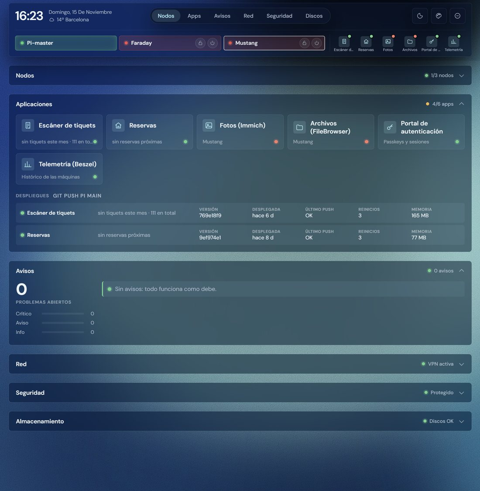<br>
<sub><b>Apps and alerts.</b> The health of every app, and the deployments made with <code>git push</code>.</sub>
</td>
<td width="50%" valign="top">
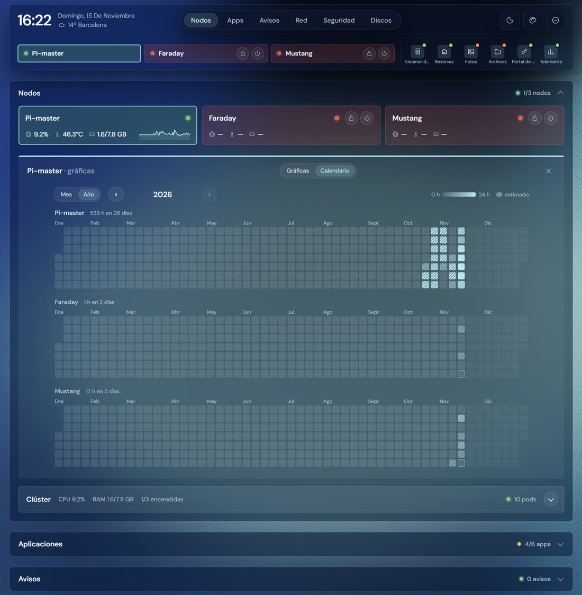<br>
<sub><b>Calendar.</b> Hours on per day and machine: the Pi never stops, the nodes only wake for work.</sub>
</td>
</tr>
<tr>
<td width="50%" valign="top">
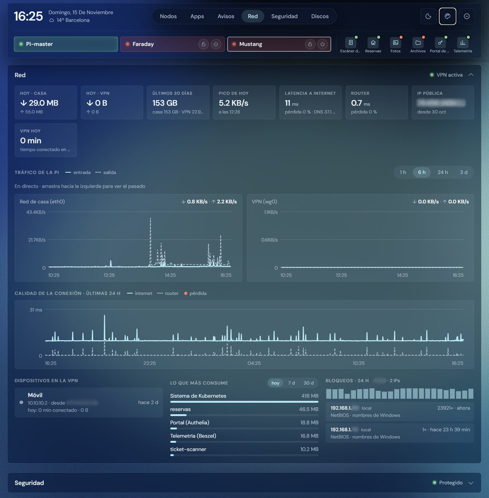<br>
<sub><b>Network.</b> Traffic, connection quality, VPN devices and what the firewall blocks.</sub>
</td>
<td width="50%" valign="top">
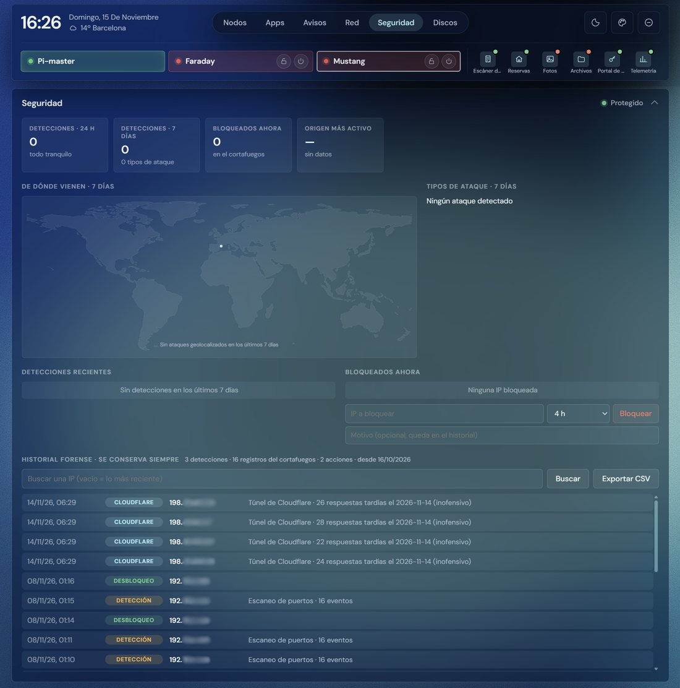<br>
<sub><b>Security.</b> CrowdSec detections, where attacks come from, and a forensic history that is never purged.</sub>
</td>
</tr>
</table>

<p align="center">
  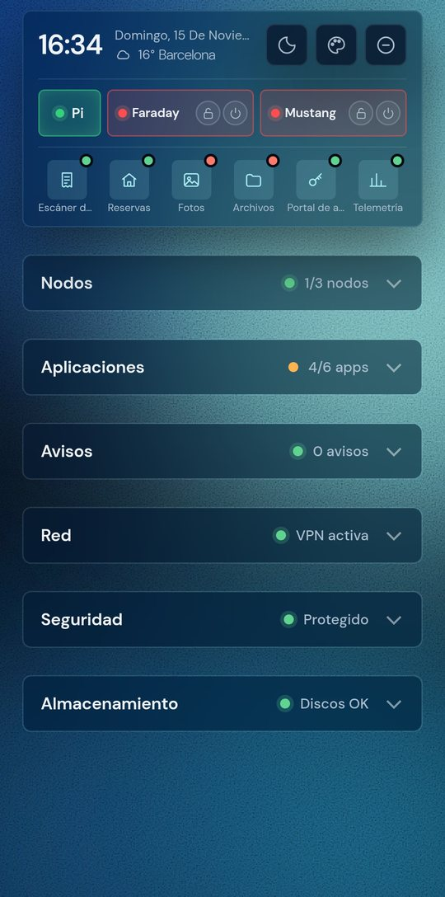
  &nbsp;&nbsp;
  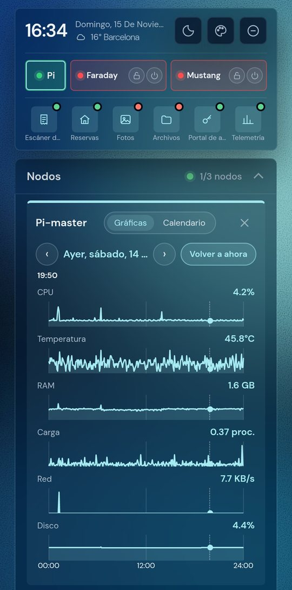<br>
  <sub><b>On the phone.</b> Installable as an app; the same page rearranges itself to fit.</sub>
</p>

### Themes

<table>
<tr>
<td width="50%" valign="top">
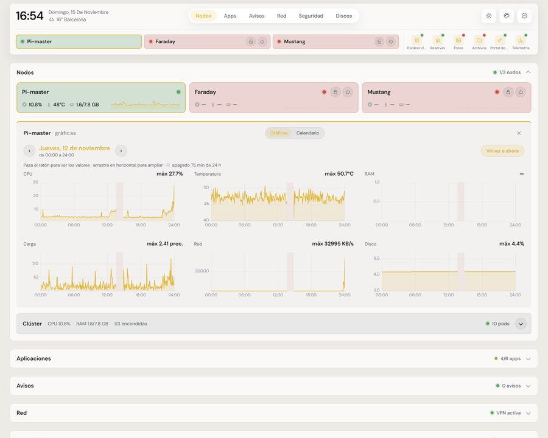<br>
<sub><b>Arena</b> · light</sub>
</td>
<td width="50%" valign="top">
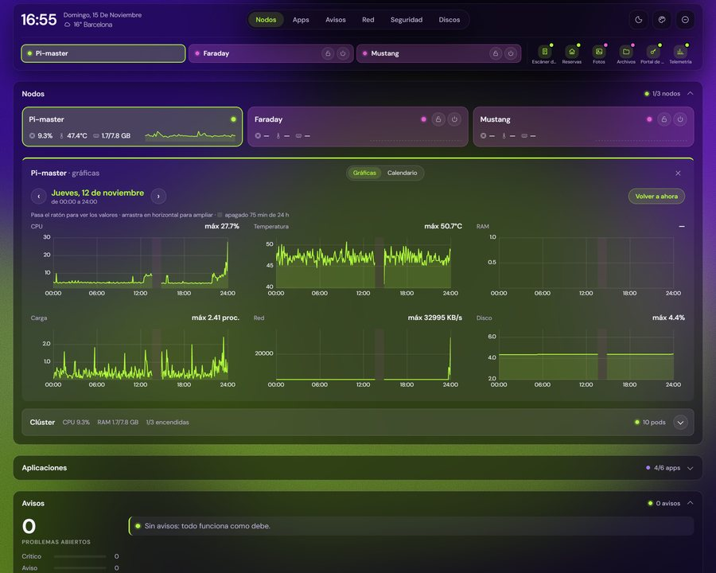<br>
<sub><b>Lima</b> · dark, with the drifting background of the palettes</sub>
</td>
</tr>
<tr>
<td width="50%" valign="top">
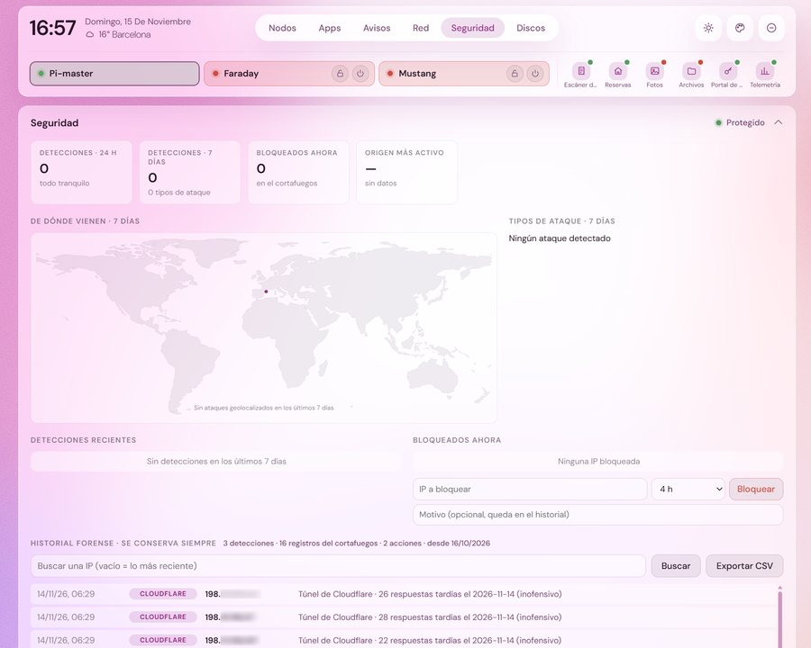<br>
<sub><b>Rojo</b> · light</sub>
</td>
<td width="50%" valign="top">
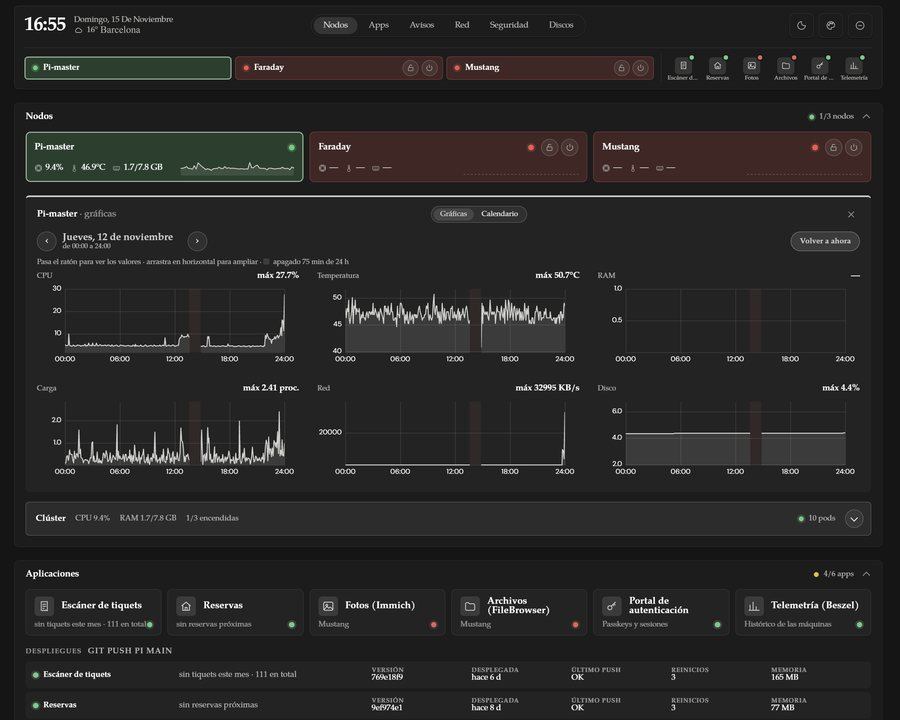<br>
<sub><b>Sobrio</b> · dark, with a serif font</sub>
</td>
</tr>
</table>

<p align="center">
  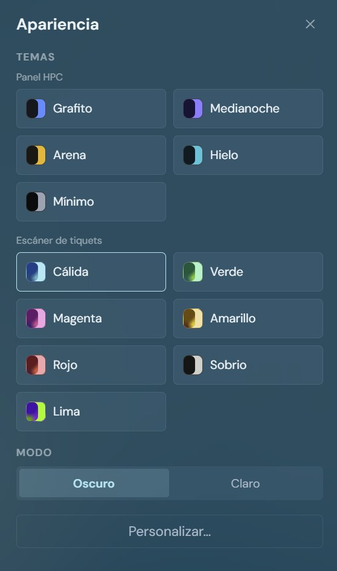
  &nbsp;&nbsp;
  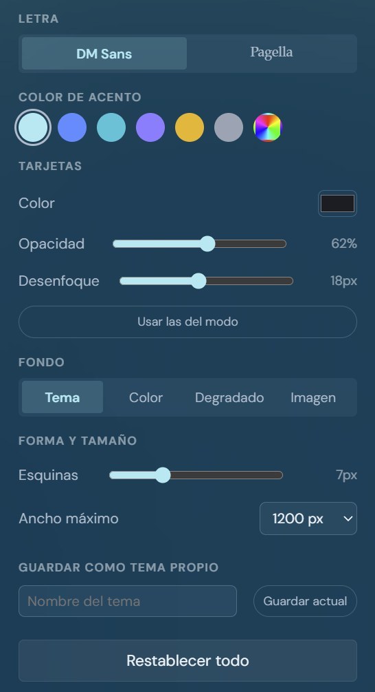<br>
  <sub>Every theme has a light and a dark version, and everything can be tuned and saved as your own theme:
  font, accent, card opacity and blur, background (colour, gradient or image), corners and width.</sub>
</p>

---

## What runs on it

<table>
<thead><tr><th align="left">Service</th><th align="left">Node</th><th align="left">What for</th></tr></thead>
<tbody>
<tr><td valign="top"><b>Dashboard</b></td><td valign="top">Pi</td><td>Cluster status, power control, network and security views</td></tr>
<tr><td valign="top"><b>Authelia</b></td><td valign="top">Pi</td><td>Login portal for every service</td></tr>
<tr><td valign="top"><b>Beszel</b></td><td valign="top">Pi&nbsp;+&nbsp;agents</td><td>Metrics history</td></tr>
<tr><td valign="top"><b>Immich</b></td><td valign="top">GPU&nbsp;node</td><td>Photo library and phone backup; wakes the node when the app connects</td></tr>
<tr><td valign="top"><b>FileBrowser&nbsp;Quantum</b></td><td valign="top">GPU&nbsp;node</td><td>Files over HTTPS with single sign-on</td></tr>
<tr><td valign="top"><b><a href="https://github.com/Ipasky/ticket-scanner">ticket&#8209;scanner</a></b></td><td valign="top">Pi</td><td>My own app: scan receipts with AI, match them to bank transactions, see where the money goes</td></tr>
<tr><td valign="top"><i>your app here</i></td><td valign="top">Pi</td><td>Anything with a <code>Dockerfile</code> and its manifests, deployed with <code>git push</code></td></tr>
</tbody>
</table>

---

## Hardware

<table>
<thead><tr><th align="left">Machine</th><th align="left">Hardware</th><th align="left">Role</th><th align="center">Power</th></tr></thead>
<tbody>
<tr><td valign="top"><b>pi&#8209;master</b></td><td valign="top">Raspberry Pi 5, 8 GB, SSD over USB</td><td valign="top">Control plane and every always-on service</td><td valign="top" align="center">Always&nbsp;on</td></tr>
<tr><td valign="top"><b>faraday</b></td><td valign="top">Intel i5-4690, 16 GB</td><td valign="top">CPU node · backup disk</td><td valign="top" align="center">On&nbsp;demand</td></tr>
<tr><td valign="top"><b>mustang</b></td><td valign="top">Intel i7-7700K, 16 GB, NVIDIA GTX&nbsp;1050&nbsp;Ti</td><td valign="top">GPU node (CUDA) · NAS (3 TB)</td><td valign="top" align="center">On&nbsp;demand</td></tr>
</tbody>
</table>

A Blender Cycles test render (1080p, 128 samples) takes **83 s on the GPU node** and **328 s on the CPU
node**. Both are woken, used and put back to sleep automatically.

---

## Documentation

### Installation guide

A step-by-step guide to build the same cluster on your own hardware: **[start here](docs/guide/README.md)**.

<table>
<tr>
<td valign="top" width="50%">

**I · Foundations**

0. [Plan & prerequisites](docs/guide/00-plan.md)
1. [Prepare the machines](docs/guide/01-machines.md)
2. [Firewall](docs/guide/02-firewall.md)
3. [K3s](docs/guide/03-k3s.md)

</td>
<td valign="top" width="50%">

**II · Power & access**

4. [Wake-on-LAN & controller](docs/guide/04-power.md)
5. [Domain & HTTPS](docs/guide/05-https.md)
6. [VPN](docs/guide/06-vpn.md)
7. [Single sign-on](docs/guide/07-sso.md)

</td>
</tr>
<tr>
<td valign="top" width="50%">

**III · Services**

8. [The dashboard](docs/guide/08-dashboard.md)
9. [Monitoring](docs/guide/09-monitoring.md)
10. [NAS](docs/guide/10-nas.md)
11. [CrowdSec](docs/guide/11-crowdsec.md)

</td>
<td valign="top" width="50%">

**IV · Operations**

12. [Backups](docs/guide/12-backups.md)
13. [Deploying your apps](docs/guide/13-apps.md)

</td>
</tr>
</table>

### Design decisions & lessons learned

<table>
<thead><tr><th align="left">Document</th><th align="left">What you will find</th></tr></thead>
<tbody>
<tr><td valign="top"><a href="docs/decisions.md"><b>Design&nbsp;decisions</b></a></td><td>14 decisions: context, choice, rejected alternatives and consequences (K3s vs. Slurm, full power-off vs. suspend, Authelia vs. Authentik…)</td></tr>
<tr><td valign="top"><a href="docs/lessons-learned.md"><b>Lessons&nbsp;learned</b></a></td><td>About 45 real problems as <i>symptom → cause → fix</i>: hardware, firewall, K3s, security, storage, deployment</td></tr>
</tbody>
</table>

---

## Quick start

Every value that belongs to a specific installation (domain, IP and MAC addresses, user names) is
written in the files as an `@@MARKER@@`. Your values live in `config/local.env`, which git ignores:

```powershell
copy config\local.env.example config\local.env   # then edit it
git config core.hooksPath .githooks              # block commits that contain your private values
.\deploy\desplegar.ps1 -Probar                   # dry run: what would be sent where
.\deploy\desplegar.ps1                           # fill in the markers and install on every machine
.\deploy\desplegar.ps1 -Generar                  # render k8s/ and the firewall files to apply by hand
```

New here? Follow the [installation guide](docs/guide/README.md) from chapter 0.

---

## Repository layout

```
├── panel/            The dashboard: despertador.py (FastAPI) + static/ (UI)
├── scripts/          nodo · nodo-controlador · hpc-respaldo · desplegar-app · …
├── systemd/          Services and timers for those scripts
├── k8s/              K3s manifests: Traefik, Authelia, Immich, FileBrowser, dashboard route…
├── config/           nftables per machine · CrowdSec · *.example configuration files
├── docs/             Installation guide · design decisions · lessons learned · diagrams
├── tools/            Development helpers
├── .githooks/        Pre-commit guard against publishing private values
└── deploy/           desplegar.ps1 (from the admin PC: render, copy and install on each machine)
                      instalar.sh (runs on each machine: puts every file in place, reloads systemd)
```

> The code comments and the dashboard UI are in Spanish; the documentation is in English.

---

## Roadmap

- [x] Wake-on-demand nodes, power controller and wake-on-access
- [x] VPN, single sign-on, CrowdSec, encrypted backups, `git push` deploys
- [x] [Design decisions](docs/decisions.md), [lessons learned](docs/lessons-learned.md) and the [installation guide](docs/guide/README.md)
- [x] Dashboard screenshots
- [ ] Off-site copy of the backups (restic → cloud storage)
- [ ] Backups of the photo library
- [ ] Distributed Blender rendering across both nodes
- [ ] Small AI models on the GPU node
- [ ] Power consumption metering

---

## License

[MIT](LICENSE) © Isaac Pascual · Fonts: see [`panel/LICENCIAS-FUENTES.md`](panel/LICENCIAS-FUENTES.md)

<p align="right"><sub><a href="#top">↑ Back to top</a></sub></p>
